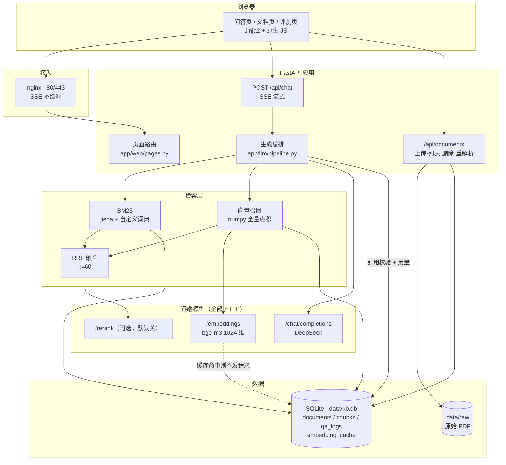

# 工业设备运维知识库

把设备手册变成**可溯源**的问答：每条结论后面都带 `[文档名 p.页码]`，查不到就回「资料中未找到相关内容」并说明缺什么，而不是编一段听起来靠谱的话。

> 面向的现场场景：工人手上只有一台手机和一句「上电就报 Err23」，需要在一本 74 页的手册里找到那一行处理办法。

---

## 它具体做了什么

- **混合检索**：BM25（术语与型号，如 `CP600-4T22G`、`Err23`）+ 向量语义（「上电无显示」↔「无法开机」），RRF 融合，外加一条「确切标识符强匹配」通道。指标见下方「评测结果」。
- **只依据片段回答**：提示词禁止模型使用片段以外的知识；来源由检索给定（每段自带 `<cite>` 标签），模型只能原样复制。
- **引用可机械核验**：`tests/check_citations.py` 逐条核对回答里的 `[文档名 p.页码]` 是否真的存在于本次检索结果，结果见下方表格。
- **会拒答**：问「出厂序列号规则」「维修报价」这类手册里没有的东西，会明确拒答并指出缺哪类信息，而不是编一段。
- **结论有据（第二道闸）**：不止核对「这个来源存在」，还把结论里的数值/型号/故障码抽出来，
  逐个到被引用的块里找原文；同义改写这类规则判不了的句子记为「无法判定」，不充数。
- **本机不装模型**：向量、重排、对话全部走 HTTP 接口；存储用 SQLite 单文件。13 个运行时依赖、装完约 420MB（其中 OCR 的 opencv + onnxruntime 占 160MB），没有 torch / Paddle / Postgres——后者光框架就要 5GB 起。

---

## 架构



入库链路：`data/raw` → PyMuPDF / python-docx 解析 → 表格转 Markdown、扫描页走 RapidOCR → 按标题层级切块（400–800 字，100 字重叠）→ 写 `chunks` → 调 `/embeddings` 补向量。

---

## 评测结果

> **数字只在这一节维护。** 其余章节只写结论、不重述具体数值，避免改一处漏三处。
> 重跑后先更新 `results/report.md`（脚本生成），再同步这里；`tests/test_docs.py` 会检查两边是否一致。

**检索**（59 条题库 / 48 条可评分，3 份手册 163 页 203 块，`BAAI/bge-m3`）

| 模式 | 块级 Recall@5 | 页码级 | 文档级 | 中位耗时（冷查询） |
| --- | --- | --- | --- | --- |
| `vector` | 0.854 | 0.854 | 0.979 | 约 345ms |
| `hybrid` | **0.979** | 0.979 | 1.000 | 约 330ms |
| `hybrid_rerank` | 0.979 | 0.979 | 1.000 | 约 340ms（重排默认关闭，透传） |

按题型拆开看 `hybrid`：查表型 1.000（27 题）、推理型 0.929（14 题）、跨文档 1.000（7 题）。
只剩 q035（「断电后等多久能拆盖板」）没命中——**它不带任何型号/故障码标识符**，
强匹配通道帮不上，靠语义又差一口气。这是当前唯一的检索缺口。

> 0.938 → 0.979 来自一次**单变量改动**：查询里出现确切标识符（`F4-01`、`CP600`、`DI2`）时，
> 同时包含这些标识符的块（≤3 个）提到融合结果最前。改动原因与 A/B 记录见 `docs/DESIGN.md`。

> 这张表用**块级金标**（金标是出题时依据的那个 chunk），比页码级严格：一页有多个块时，
> 命中「接线示意图」不再算成功。Recall 是稳定的（多轮一致）；**耗时不要抠单个数字**——
> 关缓存冷查询在不同轮次实测 325–475ms，全是远端 embedding 往返的网络抖动。

**生成与引用**（`deepseek-flash`，59 条题，其中 11 条是库里确实没有的）

| 指标 | 结果 |
| --- | --- |
| 可答题作答 | **47 / 48**（连跑三轮一致） |
| 引用总数 / 不存在的引用 | 92 / **0**（准确率 100%；多轮 90–94） |
| 无答案题拒答 | 11 / 11，且都指出缺的是哪类信息 |
| **结论支撑性**（规则版二次校验） | 154 条可判定结论全部通过（**含数字级宽松匹配**），另有 85 条定性描述判不了；多轮 146–160 |
| 单次生成耗时 | 1.5–5.4s（含首 token 等待） |
| 单次 token | 2.2k–5.6k |

唯一没答出来的是 **q018（DB9 接口上急停接哪个 DI 端子）**：金标块排 top-1，但它的正文是接线图被压平后的样子——

```
| T1A |  |  |  | -2P +2P | … | COM1 24V COM DI6 |
```

信息在，格式烂到模型不敢用。这是**图/表解析**的真实边界，不是模型偷懒。

> 早先这张表写「45–47 波动」，是**测量错**，不是模型不稳：`is_refusal` 用了
> `REFUSAL_MARKER in answer` 全文包含判定，而模型常「先答完、再补一句片段里没有 X」
> （q008、q045 都是这种诚实回答），被错算成拒答。改成「结论段只有未找到 + 全篇无引用」
> 之后，三轮都是 47/48。这条教训写进了 `docs/DESIGN.md`。

> 「引用存在」和「引用支撑结论」是两件事。前者由 `citations.py` 逐条比对标签，
> 后者由 `support.py` 抽取结论里的数值/型号/故障码，再去被引用的块里找原文。
> 两次校验的分母不同：91 个引用、151 条可判定结论。

**门禁口径**：CI 的退出码只看「有没有编造」——0 条幻觉引用、0 条该拒答却作答、0 条作答但零引用。
「该答没答」（误拒）逐题记录、不阻塞构建，当前 1/48。把两者混成一个布尔值，CI 会因为
1 条误拒长期红，红久了就没人看了。

明细：`data/eval/p3_citations.json`；重跑：`python tests/check_citations.py --queries data/eval/questions.jsonl`。

### 跨厂商压测（工具就绪，尚未跑真实外部手册）

现有参数是在三份同源手册上调出来的。要回答「换个厂的行不行」，得拿没见过的 PDF 直接入库、
**不做任何调参**，只记录失败在哪一层：

```bash
# 1. 把下载来的手册放进 data/foreign/（不要放 data/raw，避免污染主库）
# 2. 跑压测：独立库、不建向量、不花 embedding 的钱
python -m app.eval.stress_ingest
# 3. 看 results/stress_report.md：解析失败 / OCR 占比 / 双栏串行 / 表格塌陷 / 超长块
```

它输出的是**失败清单**而不是分数——那种清单才能拿去答辩（「我在 N 份陌生手册上验证过，
已知失效模式有三种」）。**当前仓库没有跑过这一步**，因为需要外部手册。

表格问题分两档，别混着看：**列错位**（数据行列数对不上，模型照着错的表读会给出错数值，值得修）
与**表头合并被拍平**（跨列表头变空单元格，数据行仍对齐，轻度）。报告最后一列是
「人工复核（待填）」——工具判的与人确认的必须分开记，否则那份清单会自己把自己毁掉。

自测记录：拿自己那份干净的 CP600 跑，24 个含表格的块里判出「列错位 1、表头合并 5」。
第一版判定只会报「1 份塌陷」，其实是把合并表头也算进去了；改成两档后，
那 1 处列错位对应的是 HMI 界面截图被摊平成单行表格，是真问题。

---

## 快速开始（10 分钟）

### 方式一：不配任何 key，先跑通整条链路（推荐第一次）

**第 0 步：准备一份手册。** 仓库不附带任何真实文档与评测集（手册有版权，评测集含真实页码），
把 1~2 份 PDF / DOCX / 扫描图片放进 `data/raw/` 即可。没有现成文件时，任何自己能拿到的设备说明书都行。

```bash
python -m venv .venv
source .venv/bin/activate          # Windows: .venv\Scripts\activate
pip install -r requirements.txt    # 约 420MB，无 torch，3 分钟左右

cp .env.example .env
# 编辑 .env，把 MOCK_MODE 改成 1（其余不用填）

python -m app.ingest.pipeline data/raw       # 解析 + 切块，1 份 70 页手册约 1 分钟
python -m app.retrieval.bench --rebuild      # 建向量与 BM25 索引（MOCK 模式几秒）
uvicorn app.main:app --port 8000             # 打开 http://127.0.0.1:8000
```

如果 `data/raw` 是空的，入库会提示「找到 0 个支持的文件」并正常退出——先放文件再跑。

`MOCK_MODE=1` 时向量、重排、对话全部由本地桩模型替代：链路完整、回答带「MOCK」标记，**但不代表真实模型效果**。

### 方式二：接真实模型

在 `.env` 里填两组 key（缺一不可）：

```ini
MOCK_MODE=0
EMBED_BASE_URL=https://api.siliconflow.cn/v1   # 任意 OpenAI 兼容 /embeddings
EMBED_API_KEY=...
EMBED_MODEL=BAAI/bge-m3
EMBED_DIM=1024
LLM_BASE_URL=https://api.deepseek.com          # 任意 OpenAI 兼容 /chat/completions
LLM_API_KEY=...
LLM_MODEL=deepseek-flash
```

然后重新建索引并验收：

```bash
python -m app.retrieval.bench --rebuild
python -m pytest                              # 82 个测试，真实模型下会真的发几次请求
python tests/check_citations.py --out results/report.json
```

`check_citations.py` 读题库，每行一道题。仓库自带的是 `data/eval/questions.jsonl`（59 条，
由 `python -m app.eval.generate_questions` 从你的语料里出题，再人工删过一轮）；
早期还有一份 10 条的手写集 `smoke_queries.jsonl`，只跑检索评测时用：

```json
{"id": "q01", "type": "lookup", "query": "上电无显示怎么排查", "gold": [{"chunk_id": 42, "doc": "CP600空压机一体机手册.pdf", "page": 30}], "note": ""}
{"id": "q02", "type": "unanswerable", "query": "出厂序列号规则是什么", "gold": [], "expect": "refusal", "note": "语料里确实没有"}
```

`expect: "refusal"` 表示「这题语料里没有，应当拒答」，是拒答率的分母；缺 `gold` 又没这个标记会直接报错，
避免少标一行就变成「怎么答都算对」。

`gold` 填答案实际所在的文档名与页码（照入库后的块反查，不要照检索结果回头改）。
没有评测集时脚本会以退出码 2 明确告诉你缺文件，不会假装通过。

### 方式三：双击启动（已装好依赖时最省事）

Windows 双击项目根目录的 **`start.bat`**：它会检查 `.venv`、拉起服务、等 `/health` 就绪后自动打开浏览器；
服务如果已经在跑，就只打开页面。停止服务＝关掉标题为「知识库服务」的那个命令行窗口。

Linux / macOS 用 `./start.sh`（同样会自动打开浏览器，Ctrl+C 停止）。

> 注意这是**服务端渲染**的页面，直接双击 `web/templates/*.html` 打开是坏的：
> 里面是 Jinja 模板，样式和接口都走 `/static`、`/api`，必须有后端在跑。

### 方式四：Docker

```bash
docker compose up -d --build      # 打开 http://localhost（nginx 反代）
```

公网部署（含域名与 HTTPS）见 [`DEPLOY.md`](DEPLOY.md)。

---

## 三个页面

| 页面 | 能做什么 |
| --- | --- |
| `/` 问答 | 输入故障现象、切换三种检索模式；回答逐字流式出现；下方引用卡片可点开看原文与页码 |
| `/documents` 文档 | 上传 PDF/DOCX/图片，后台解析并自动建索引；看状态、页数、块数；删除、重新解析 |
| `/eval` 评测 | 把报告 Markdown 渲染成表格，可切换报告文件 |

截图占位（补图时建议 390px 手机宽度 + 桌面各一张）：

| 问答页 | 文档页 | 评测页 |
| --- | --- | --- |
| `` | `` | `` |

---

## 目录说明

```
app/
├── config.py          唯一的配置入口（读 .env）
├── db.py              引擎、会话、建表、连通性探测
├── models.py          六张表：documents / chunks / embedding_cache / eval_runs / eval_results / qa_logs
├── ingest/            解析 → OCR → 切块 → 入库
├── retrieval/         BM25、向量、RRF 融合、评测 CLI
├── llm/               embed / rerank / client / prompt / citations / pipeline / mock
├── eval/              generate_questions（出题）、run_eval（块级金标评测）、stress_ingest（跨厂商压测）
├── web/               页面路由 + 极简 Markdown 渲染
└── api/               chat（SSE）、documents、chunks
web/                   templates（4 个）+ static（css + 3 个 js）
deploy/                nginx HTTP/HTTPS 配置
tests/                 pytest + check_citations.py（引用准确率 + 结论支撑性校验）
.github/workflows/     CI：桩模式跑全量测试；配了 key 时再做一次小规模验收
data/                  raw（原始文档）、kb.db（SQLite）、dict.txt（jieba 词典）
data/eval/             questions.jsonl（59 条题库）、smoke_queries.jsonl（10 条旧集）、p3_citations.json（验收产物）
docs/                  DESIGN.md（设计取舍）、DEMO.md（演示脚本）、RESUME.md（简历 bullet）
```

---

## 已知限制

- **引用真实 ≠ 引用支持结论**：`citations.py` 只证明 `[手册 p.24]` 存在；`support.py` 用规则补了一层
  （数值 / 型号 / 故障码是否出现在引用块里），但**只覆盖这三类可机械比对的事实**——
  「应先断电再拆盖」这种定性结论、以及同义改写（「10 平方」vs `10mm²`），仍然只能人工抽查。
  另外它放过了「数字对、单位错」的情况（例如块里是 16A 而结论写 16mm²），这一条是已知的宽松处。
- **页码级 Recall@5 会高估**：一页有多个块时，命中「接线示意图」也算命中，而真正回答问题的「选型表」可能排在第 8。
- **表格是原子块**：合并单元格会转成错位的 Markdown，读表可能读错。
- **不做登录**：演示用，任何拿到地址的人都能上传与删除。

更细的失败模式见 [`docs/DESIGN.md`](docs/DESIGN.md)。

---

## 文档

| 文件 | 内容 |
| --- | --- |
| [`PROJECT_SPEC.md`](PROJECT_SPEC.md) | 规格书：数据模型、接口、各阶段规则与验收记录 |
| [`docs/DESIGN.md`](docs/DESIGN.md) | 四个设计问题：为什么混合检索、为什么这样切块、重排值不值、什么时候会答错 |
| [`docs/DEMO.md`](docs/DEMO.md) | 三分钟演示脚本（按秒） |
| [`DEPLOY.md`](DEPLOY.md) | 从空 VPS 到 HTTPS |
